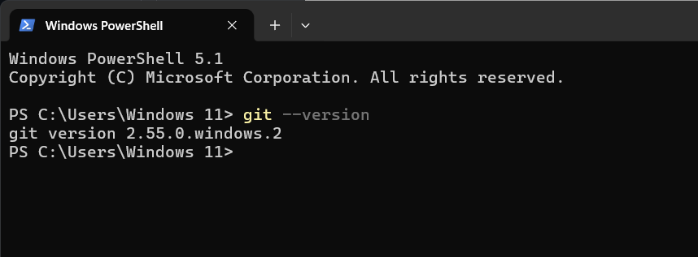
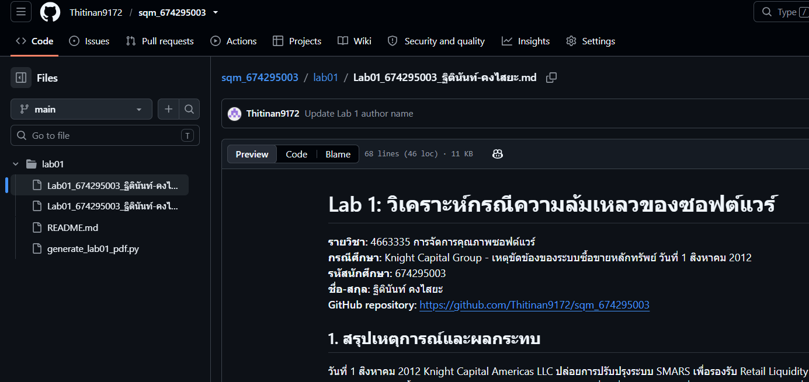
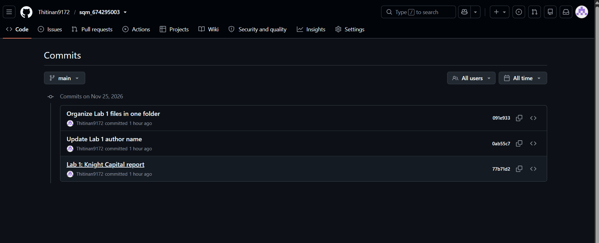

# Lab 1: วิเคราะห์กรณีความล้มเหลวของซอฟต์แวร์

**รายวิชา:** 4663335 การจัดการคุณภาพซอฟต์แวร์  
**กรณีศึกษา:** Knight Capital Group - เหตุขัดข้องของระบบซื้อขายหลักทรัพย์ วันที่ 1 สิงหาคม 2012  
**รหัสนักศึกษา:** 674295003  
**ชื่อ-สกุล:** ฐิตินันท์ คงไสยะ  
**GitHub repository:** https://github.com/Thitinan9172/sqm_674295003

## 1. สรุปเหตุการณ์และผลกระทบ

วันที่ 1 สิงหาคม 2012 Knight Capital Americas LLC ปล่อยการปรับปรุงระบบ SMARS เพื่อรองรับ Retail Liquidity Program ของตลาดหลักทรัพย์นิวยอร์ก (NYSE) แต่การติดตั้งโค้ดไม่ครบทุกเซิร์ฟเวอร์ ทำให้เซิร์ฟเวอร์หนึ่งเครื่องยังมีโค้ดเก่าที่ไม่ควรถูกเรียกใช้งานอยู่ เมื่อระบบเริ่มทำงาน โค้ดเก่านี้ถูกกระตุ้นและส่งคำสั่งซื้อขายจำนวนมากโดยไม่ตั้งใจ

เหตุการณ์ดำเนินอยู่ประมาณ 45 นาที ก่อนที่บริษัทจะหยุดระบบได้ บริษัทสะสมสถานะหลักทรัพย์โดยไม่ตั้งใจในระดับหลายพันล้านดอลลาร์สหรัฐ และเกิดความเสียหายมากกว่า 460 ล้านดอลลาร์สหรัฐ เหตุการณ์นี้กระทบตลาด ผู้ลงทุน และความน่าเชื่อถือขององค์กร [1]

## 2. การจำแนกปัญหาตามคุณลักษณะคุณภาพ

| คุณลักษณะคุณภาพ | ปัญหาที่พบ | เหตุผล |
| --- | --- | --- |
| Functional suitability | ระบบส่งคำสั่งซื้อขายที่ไม่ตรงกับความประสงค์ของลูกค้าหรือธุรกิจ | หน้าที่หลักของระบบคือประมวลผลและส่งคำสั่งซื้อขายอย่างถูกต้อง แต่โค้ดเก่าสร้างคำสั่งซื้อขายซ้ำและผิดพลาด |
| Reliability | ระบบไม่สามารถทำงานได้อย่างถูกต้องและต่อเนื่องภายใต้เงื่อนไขใช้งานจริง | ความผิดพลาดจากเซิร์ฟเวอร์เพียงเครื่องเดียวทำให้เกิดคำสั่งผิดพลาดอย่างต่อเนื่องจนต้องหยุดระบบ |
| Maintainability | การจัดการโค้ดและการติดตั้งทำให้โค้ดที่เลิกใช้แล้วยังคงอยู่ในระบบผลิตจริง | โค้ดเก่าควรถูกนำออกหรือควบคุมไม่ให้เรียกใช้ การปล่อยโค้ดจึงตรวจสอบและบำรุงรักษาได้ยาก |
| Security / operational control | ระบบขาดกลไกจำกัดความเสียหายเมื่อเกิดพฤติกรรมผิดปกติ | แม้ไม่ใช่การโจมตีทางไซเบอร์ แต่ระบบควรมีวงเงินจำกัด การแจ้งเตือน และปุ่มหยุดฉุกเฉินเพื่อลดความเสี่ยง |

## 3. จุดในวงจรพัฒนาที่ควรป้องกันหรือตรวจพบ

| ระยะของ SDLC | กิจกรรม QA เพื่อป้องกัน | กิจกรรม QC เพื่อตรวจพบ |
| --- | --- | --- |
| ความต้องการและการวางแผน | กำหนดข้อกำหนดเรื่องการควบคุมความเสี่ยง วงเงินซื้อขาย และเงื่อนไขหยุดระบบ | ทบทวนความครบถ้วนของข้อกำหนดกับทีมธุรกิจและกำกับดูแล |
| ออกแบบ | ออกแบบ circuit breaker, kill switch และการตรวจสอบความสอดคล้องของเวอร์ชันทุกเซิร์ฟเวอร์ | Design review และวิเคราะห์กรณีระบบส่งคำสั่งผิดปกติ |
| พัฒนา | กำหนดมาตรฐานการลบโค้ดที่เลิกใช้แล้วและ peer review ก่อน merge | Code review ตรวจหาโค้ดเก่า ฟังก์ชันที่ไม่ใช้ และความเสี่ยงจาก feature flag |
| ทดสอบ | จัดทำแผนทดสอบแบบ end-to-end บนสภาพแวดล้อมที่ใกล้เคียงระบบจริง | Integration test และ regression test ของทุกเซิร์ฟเวอร์และทุกเส้นทางคำสั่งซื้อขาย |
| ติดตั้ง | ใช้ขั้นตอน deployment ที่ตรวจสอบได้ มี checklist และการอนุมัติ | ตรวจเวอร์ชัน/ไฟล์บนทุกเครื่องก่อนเปิดใช้งาน และปล่อยแบบค่อยเป็นค่อยไป |
| ปฏิบัติการและบำรุงรักษา | ตั้งนโยบาย monitoring, alert และแผนรับมือเหตุขัดข้อง | เฝ้าระวังคำสั่งซื้อขายผิดปกติแบบเวลาจริง พร้อมทดสอบ kill switch เป็นระยะ |

## 4. บทวิเคราะห์

สาเหตุหลักไม่ได้เกิดจากข้อผิดพลาดในโค้ดเพียงบรรทัดเดียว แต่เกิดจากการควบคุมคุณภาพของกระบวนการปล่อยซอฟต์แวร์ที่ไม่เพียงพอ บริษัทติดตั้งเวอร์ชันใหม่ไม่ครบทุกเซิร์ฟเวอร์ ปล่อยให้โค้ดเก่าคงอยู่ และไม่มีการควบคุมหรือขั้นตอนตอบสนองต่อสัญญาณผิดปกติที่เพียงพอ [1]

ในมุม QC ทีมควรตรวจพบปัญหาจากการทดสอบการติดตั้งทุกเซิร์ฟเวอร์ การตรวจสอบเวอร์ชันหลัง deploy และการทดสอบระบบแบบ end-to-end ส่วน QA ควรวางมาตรฐาน deployment, code retirement, peer review, change approval และ incident response ตั้งแต่ต้น เหตุการณ์นี้จึงแสดงให้เห็นว่า QA ช่วยป้องกันข้อบกพร่องจากกระบวนการ ขณะที่ QC ช่วยค้นพบข้อบกพร่องในผลิตภัณฑ์และการติดตั้งก่อนจะส่งผลต่อผู้ใช้

## 5. ข้อเสนอแนะ

1. ทำ deployment แบบอัตโนมัติและยืนยัน hash/เวอร์ชันของซอฟต์แวร์ทุกเครื่องก่อนเปิดใช้
2. ใช้ code review และ change approval สำหรับการเปลี่ยนแปลงที่มีความเสี่ยงสูง
3. ลบหรือปิดกั้นโค้ดที่เลิกใช้แล้ว พร้อมบันทึกรายการโค้ดและ feature flag ที่เหลืออยู่
4. ทดสอบแบบ integration และ regression บนสภาพแวดล้อมที่เหมือนระบบจริง รวมถึงกรณี rollback
5. กำหนด trading limit, circuit breaker, dashboard และ kill switch ที่เจ้าหน้าที่ใช้งานได้ทันที

## 6. หลักฐาน GitHub และ Git

Repository: `sqm_674295003`  
URL: https://github.com/Thitinan9172/sqm_674295003

### ภาพหลักฐานที่แนบแล้ว

ภาพที่ 1 ผลการตรวจสอบเวอร์ชัน Git

ภาพที่ 2 GitHub repository `sqm_674295003` และไฟล์ในโฟลเดอร์ `lab01/`

ภาพที่ 3 ประวัติ commit ของรายงาน Lab 1

## 7. การใช้ AI

ใช้ Codex ช่วยค้นหาแหล่งอ้างอิงทางการ วางโครงร่าง และตรวจความชัดเจนของภาษา ผู้จัดทำตรวจสอบข้อเท็จจริงกับเอกสารของ SEC และเรียบเรียงเนื้อหารายงานนี้เอง โดยต้องแนบภาพหรือสำเนาบทสนทนานี้ในภาคผนวกก่อนส่งตามนโยบายรายวิชา

## อ้างอิง

[1] U.S. Securities and Exchange Commission. (2013, October 16). *SEC charges Knight Capital with violations of market access rule*. https://www.sec.gov/newsroom/press-releases/2013-222

[2] U.S. Securities and Exchange Commission. (2013). *In the matter of Knight Capital Americas LLC, Release No. 34-70694*. https://www.sec.gov/litigation/admin/2013/34-70694.pdf
